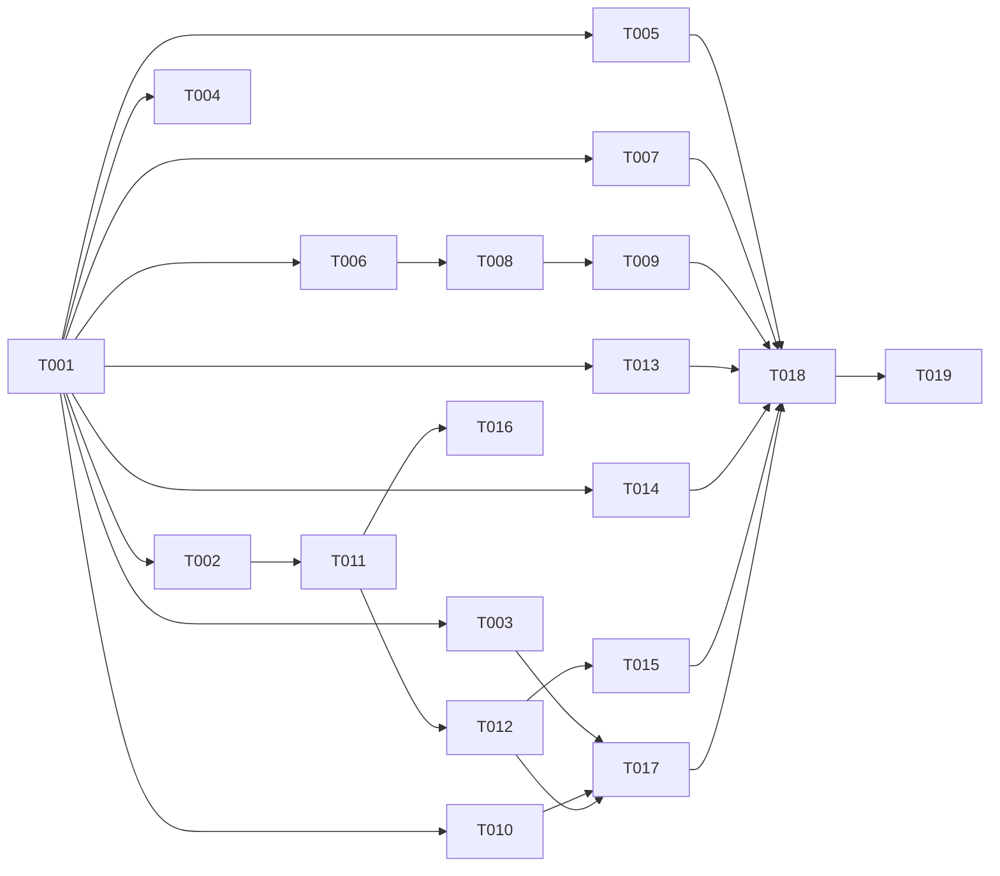

# Tasks: 006-constitution-wiring-fix

> "Never half-ass two things. Whole-ass one thing." — Рон Свонсон (_Parks and Recreation_)
> "Первые 90% проекта занимают 90% времени. Оставшиеся 10% — другие 90%." — The 90-90 rule

**Input**: Design documents from `/specs/006-constitution-wiring-fix/`
**Prerequisites**: plan.md (required), spec.md (required), research.md, requirements-audit.md (PASS), qa/preliminary-rtm.md (verification карта)

**Tests**: тестовые задачи в классическом смысле отсутствуют (runtime-поверхности нет, NFR-003); верификация = исполняемые AC каждой задачи (grep/exit-code/командный вывод), зафиксированные в `qa/preliminary-rtm.md` и чек-листе T018. Evidence-protocol XII.4 обязателен для каждого `[x]`.

**Organization**: задачи сгруппированы по user stories (US1 enforcement truth, US2 docs truth, US3 completeness). Ветки: планирование = `specs/006-...`; реализация = `006-...` от main (Principle IX, создаёт `/speckit.implement`).

## Format: `[ID] [AGENT] [Story?] Description`

- **[AGENT]**: Specialist agent responsible for the task
- **[Story]**: Which user story this task belongs to (US1/US2/US3)
- Include exact file paths in descriptions
- Parallelism is derived from the Dependency Graph

## Agent Tags

| Tag       | Agent                   | Domain (в этой спеке)                                     |
| --------- | ----------------------- | --------------------------------------------------------- |
| `[SETUP]` | — (orchestrator)        | baseline/манифесты, amend-бандл, evidence-чеклисты, финальные гейты |
| `[DOC]`   | documentation-writer    | правки always-on документации и команд (.claude/commands, AGENTS.md, CLAUDE.md) |
| `[OPS]`   | devops-engineer         | скрипты тегирования (bash/ps1), hook-файлы                  |

`[DB]`/`[BE]`/`[FE]`/`[E2E]`/`[SEC]` не используются: ноль schema/API/UI/тестового кода (NFR-003), STRIDE N/A.

## Task Statuses

| Status  | Meaning                                    |
| ------- | ------------------------------------------ |
| `- [ ]` | Pending                                    |
| `- [→]` | In progress                                |
| `- [X]` | Completed (+ inline evidence `path:line` / command output) |
| `- [!]` | Failed                                     |
| `- [~]` | Blocked (cascade from a failed dependency) |

## Path Conventions

- Изменения по месту в конфигах репо; evidence-артефакты в `specs/006-constitution-wiring-fix/verification/`.
- Реализация на ветке `006-constitution-wiring-fix` от `main`; каждый логический коммит точечен (rollback = `git revert`, см. plan §Recovery).

---

## Phase 1: Setup (Shared Infrastructure)

**Purpose**: зафиксировать состояние «до» и манифест amend-коммита — общая инфраструктура для всех US.

- [X] T001 [SETUP] Baseline evidence: выполнить 11 grep/ls-проверок находок аудита (analyze RTM = 0, Intent Routing = 0, «inactive here» = 1, IX «via CI workflow» = 1, dispatch /bump|/brainstorm|/questions, CLAUDE.md base-green|sweep-reds|_tasks, knowledge/patterns отсутствует, dialog-capture не зарегистрирован, snapshot exit 2 на requirements-audit) и записать выводы команд в specs/006-constitution-wiring-fix/verification/baseline.md — Evidence: `specs/006-constitution-wiring-fix/verification/baseline.md:1-40` (base-sha `bb2fbb1bae`, 11/11 captured)
- [X] T002 [SETUP] Манифест amend-бандла: записать в specs/006-constitution-wiring-fix/verification/amend-bundle.md точный список правок constitution.md (секции IX :135, адаптационная заметка :5, новый XIV, абзац V, пометка I, VIII.1 :97 CLAUDE.md→AGENTS.md — F2, changelog 1.9.1) и зависимых файлов (speckit.plan.md, speckit.qa-signoff.md) — один коммит v1.9.1 по Governance §2 (ADR-001) — Evidence: `specs/006-constitution-wiring-fix/verification/amend-bundle.md:1-40` (7 constitution edits + 2 command files)

**Checkpoint**: baseline и манифест зафиксированы — US-задачи могут стартовать.

---

## Phase 3: User Story 1 - Enforcement Truth (Priority: P1) 🎯 MVP

**Goal**: заявленные гейты реально исполняются: analyze проверяет RTM+XII.4, Intent Routing канон живёт в AGENTS.md, snapshot-скрипт тегирует XII-стадии.

**Independent Test**: grep-AC T003/T006/T007 + exit-код тесты T004/T005 на новых и старых именах стадий.

### Implementation for User Story 1

- [ ] T003 [DOC] [US1] FR-001: доработать .claude/commands/speckit.analyze.md: (0) в §2 Load Artifacts добавить загрузку requirements-audit.md и qa/{rtm-matrix,preliminary-rtm,waiver}.md (F3); (1) после §D. Constitution Alignment — чек RTM coverage с CRITICAL-севером: каждый FR/NFR → ≥1 TC, Risk ≥ 20 → DT+ST+EC+UAT (verbatim constitution §XII :167), с waiver-оговоркой: при наличии qa/waiver.md покрытие проверяется по qa/preliminary-rtm.md (каждый FR/NFR → ≥1 исполняемый AC) — иначе гейт ложно CRITICAL на chore-спеках; (2) чек Evidence-Backed Completion XII.4: `[x]` без inline evidence (`path:line` / test ID / command output path) = CRITICAL, reopen (:172), поиск строго `- \[[xX]\] T\d+` по строкам задач (регистронезависимо), исключая Self-Validation Checklist (F3). Evidence: grep `RTM` > 0, `Evidence-Backed` > 0, `preliminary-rtm` > 0, waiver-оговорка присутствует, цитаты §XII
- [ ] T004 [OPS] [US1] FR-003 (bash): расширить case-валидацию .specify/scripts/bash/snapshot-stage.sh:25-27 именами `requirements-audit|test-design|qa-signoff` (обратная совместимость NFR-004). Evidence: exit 0 + тег на всех 3 новых именах; exit 0 на 6 старых (spec|clarify|plan|tasks|review|bizplan); тестовые теги удалить после прогона
- [ ] T005 [OPS] [US1] FR-003 (ps1): синхронно расширить список стадий в .specify/scripts/powershell/snapshot-stage.ps1. Evidence: `-Stage requirements-audit -Slug <test-slug>` exit 0; тестовый тег удалить
- [ ] T006 [DOC] [US1] FR-002 (a+b+c): AGENTS.md — добавить `## Intent Routing` (таблица utterance→command — источник правды; intent-hint.sh и dispatch.md синхронизируются с ней через T007/T010; маршруты: repair /fix-tests /fix-ci /fix-types /resolve-conflicts; investigation → spawn debugger + systematic-debugging; spec/implement → /speckit.start пайплайн; session-end → /improve; brainstorm → /speckit.brainstorm; release → /speckit.bump), канон-блок ≤10 строк (путь конституции, что гейтит, /dispatch, two-phase Principle IX), precedence rule (ADR-003); суммарно ≤ +60 строк (NFR-001). Evidence: grep `## Intent Routing` + precedence-формулы; `wc -l` дельта ≤ 60; `npm run check:fabricated-docs` exit 0 (F7)
- [ ] T007 [DOC] [US1] FR-002 (d): .claude/hooks/intent-hint.sh — 4 правки (F2): комментарий `:10` «Keywords mirror the "Intent Routing" table in CLAUDE.md» → «Keywords mirror AGENTS.md § Intent Routing»; runtime-строка `:112` (CONTEXT) «matching CLAUDE.md table» → «matching AGENTS.md § Intent Routing»; подсказка `:63` `/brainstorm` → `/speckit.brainstorm`; подсказка `:95` `/bump` → `/speckit.bump`. Evidence: grep `CLAUDE.md` в хуке = 0; `AGENTS.md § Intent Routing` ≥ 2; `/speckit.brainstorm` и `/speckit.bump` присутствуют

**Checkpoint**: /speckit.analyze заявляет и исполняет XII-чеки; роутинг канонизирован; скрипт тегирует все 9 стадий конституции.

---

## Phase 4: User Story 2 - Documentation Truth (Priority: P2)

**Goal**: always-on документация перестаёт врать: amend v1.9.1, dangling refs устранены, IX-claim согласован.

**Independent Test**: grep-AC T008/T009/T010 + amend-проверки T011/T012 (grep 1.9.1, «inactive here» = 0, XIV существует).

### Implementation for User Story 2

- [ ] T008 [DOC] [US2] FR-007 (a+b): удалить секцию «## Base-green before opening PRs» из CLAUDE.md и секцию «### Base-green check (PRs must not be born red)» из AGENTS.md:571 (вместе с упоминанием /sweep-reds; ADR-004). Evidence: grep `base-green|sweep-reds` по CLAUDE.md и AGENTS.md = 0
- [ ] T009 [DOC] [US2] FR-007 (c): выпилить из CLAUDE.md секцию «Superpowers / planning artifacts — path overrides» с таблицей `_tasks/...` путей (Q5; AGENTS.md `_*`-канон Hard Rule #23 НЕ трогается — ADR-006). Evidence: grep `_tasks` по CLAUDE.md = 0
- [ ] T010 [DOC] [US2] FR-006: .claude/commands/dispatch.md — (a) битые refs `/bump`→`/speckit.bump`, `/brainstorm`→`/speckit.brainstorm`, `/questions`→`/questions_ideas`; (b) адреса таблицы CLAUDE.md→AGENTS.md в `:2` (description), `:20` (Source of truth), `:63` (Stop conditions — перенаправить на фактический дом, проверяется на implement), `:70` (Updates go through...) (F2). Evidence: каждый `/name` существует как .claude/commands/<name>.md (loop grep); grep `CLAUDE.md` по dispatch.md = 0
- [ ] T011 [SETUP] [US2] FR-004+FR-005+FR-008+FR-011+FR-013: Constitution amend v1.9.1 — ТЕКСТОВЫЕ правки .specify/memory/constitution.md по манифесту T002: (1) :5 адаптационная заметка → «Principle VIII hooks: 6 хуков зарегистрированы в settings.json с 2026-08-14 (f4c87e9099); .claude/ dual role (см. V)»; (2) IX :135 вычеркнуть «(via CI workflow)»; (3) новый `### XIV. Stage Checklists` — /speckit.plan Constitution Check и /speckit.qa-signoff MUST прогоняют применимые чеклисты .specify/checklists/ (перечень 9: accessibility, api-contract, data-migration, i18n, operational-readiness, performance, regulatory-compliance, security, spike-governance; применимость определяет план); (4) Principle V абзац dual role (template inventory vs consumer; 60-day rule к consumer-инстансам); (5) Principle I пометка «UndeRoute: .gemini/ N/A (GEMINI.md стаб достаточен)»; (6) VIII.1 :97 — `CLAUDE.md §"Intent Routing"` → `AGENTS.md §"Intent Routing"` (F2, согласовано с FR-002/NFR-005); (7) Changelog 1.9.1. ⚠️ КОММИТИТСЯ ВМЕСТЕ С T012 одним amend-коммитом (Governance §2). Evidence: grep `1.9.1` > 0; «inactive here» = 0; `XIV` section существует; «dual role» > 0; grep `CLAUDE.md` по constitution.md = 0; дельта ≤ +50 строк вне changelog (NFR-001)
- [ ] T012 [DOC] [US2] FR-008 (wiring): зависимые файлы amend-коммита — .claude/commands/speckit.plan.md (Constitution Check шаг + ссылка на XIV-перечень; плюс F4: строки 103-105 — инструкция «§6 SpecKit Integration» → «## 4. Stage map», реальная топография specs/main/architecture.md: 46 строк, ## 1..## 5) и .claude/commands/speckit.qa-signoff.md (шаг прогона применимых чеклистов из XIV-перечня). ⚠️ Один amend-коммит с T011. Evidence: grep `XIV` в обоих файлах > 0; grep `## 4. Stage map` в speckit.plan.md > 0

**Checkpoint**: документация правдива: amend v1.9.1 атомарен, dangling refs ноль.

---

## Phase 5: User Story 3 - Completeness & Hygiene (Priority: P3)

**Goal**: гигиена: knowledge staging оживлён, мёртвый hook удалён, ops-покрытие через чеклист подтверждено.

**Independent Test**: ls/grep AC T013/T014/T015.

### Implementation for User Story 3

- [ ] T013 [SETUP] [US3] FR-009: создать knowledge/patterns/INDEX.md (заголовок, `status: empty`, правило VIII: staging-зона /learn → /improve promotion). Evidence: dir + файл существуют
- [ ] T014 [OPS] [US3] FR-010: удалить .claude/hooks/dialog-capture.mjs (D2; незарегистрированный 7-й хук). Evidence: файл отсутствует; `git diff --name-only` не содержит settings.json
- [ ] T015 [DOC] [US3] FR-012+FR-013 верификация: после amend-коммита (T011+T012) подтвердить: `grep -E "^### (Principle )?XV\.?"` по constitution.md = 0 (принцип не добавлен; анкорировано против ложных подстрок — F8.2); `operational-readiness` входит в XIV-перечень; пометка N/A у `.gemini/` в Principle I. Evidence: 3 grep-вывода

**Checkpoint**: гигиена закрыта; FR-012/FR-013 AC зелёные.

---

## Phase 6: Polish & Cross-Cutting Verification

**Purpose**: transpile-гигиена, living-spec row, финальные gates.

- [ ] T016 [DOC] Polish: добавить feature-reference row для `006-constitution-wiring-fix` в таблицу `## 4. Stage map` файла specs/main/architecture.md (46 строк, ## 1..## 5 — секции §6 НЕ существует, F4; на implementation ветке). Evidence: grep `006-constitution-wiring-fix` в architecture.md
- [ ] T017 [SETUP] Polish (F1-corrected): `node packages/cli/bin/helpers.mjs regen --targets copilot` (Principle I: правки .claude/commands/*.md = T003/T010/T012 требуют transpile; `npx clai-helpers sync/status` неисполнимы — нет helpers-lock.json и пакета в root devDeps, sync.ts:352/status.ts:49; `--targets copilot` исключает генерацию `.gemini/` вопреки FR-013 — ADR-009). Evidence: regen exit 0; regenerated-файлы закоммичены и `git diff --exit-code .github/` чист; `.gemini/` отсутствует. Fallback при EMFILE (глоб `.claude/worktrees/**`): добавить ignore worktrees в helpers.config.ts (root-конфиг, NFR-003 не запрещает) и повторить
- [ ] T018 [SETUP] Polish: прогнать SC-001..005 чек-лист из qa/preliminary-rtm.md (все AC 18 требований: 6 dangling-grep, wc -l бюджеты NFR-001, exit-тесты скрипта NFR-004, NFR-005 single source), + M1-митигация: все /команды из ## Intent Routing AGENTS.md существуют как .claude/commands/<name>.md (antigravity alternative #1) + `npm run check:fabricated-docs` exit 0 (F7); записать выводы в specs/006-constitution-wiring-fix/verification/sc-checklist.md (XII.4 evidence). Evidence: файл с 18/18 PASS + 2 доп-чека
- [ ] T019 [SETUP] Polish: NFR-003 финальный gate: `git diff --name-only <base-sha>...HEAD` против path-фильтра `src/|packages/|electron/|docker/|.github/workflows/` = пусто; base-sha = коммит main перед стартом implement, фиксируется в verification/baseline.md (main уже содержит planning-суиту bb2fbb1bae — F5). Evidence: вывод команды в sc-checklist.md

**Checkpoint**: все gates зелёные — спека готова к merge planning PR → implementation ветка финализирована.

---

## Dependency Graph

### Legend

- `→` means "unlocks" (left must complete before right can start)
- `+` means "all of these" (join point)
- Фазы — sync barriers (шаблон: все задачи фазы завершены до следующей)

### Dependencies

T001 → T002, T003, T004, T005, T006, T007, T010, T013, T014
T002 → T011
T006 → T008
T008 → T009
T011 → T012
T012 → T015
T003 + T010 + T012 → T017
T005 + T007 + T009 + T013 + T014 + T015 + T017 → T018
T018 → T019
T011 → T016

### Self-Validation Checklist

> - [x] Every task ID in Dependencies exists in the task list (T001–T019)
> - [x] No circular dependencies
> - [x] No orphan task IDs
> - [x] Fan-in uses `+` only, fan-out uses `,` only
> - [x] No chained arrows on a single line

Примечания: T006→T008 и T008→T009 — same-file sequencing внутри одной [DOC] lane (AGENTS.md, CLAUDE.md), исключает shared-file race (правило analyze §G); T011+T012 = один amend-коммит (ADR-001), constitution.md редактируется ровно одной задачей T011.

---

## Dependency Visualization

---

## Parallel Lanes

| Lane | Agent Flow | Tasks | Blocked By |
| ---- | ---------- | ----- | ---------- |
| 1 | [SETUP] | T001 → T002 → T011 → T013; T018 → T019 | — |
| 2 | [DOC] | T003; T006 → T008 → T009; T007; T010; T012 (после T011); T015; T016 | T001; T012/T015/T016 также T011 |
| 3 | [OPS] | T004; T005; T014 | T001 |

---

## Agent Summary

| Agent   | Task Count | Can Start After |
| ------- | ---------- | --------------- |
| [SETUP] | 7          | T001 (T011 после T002; T018 после T017) |
| [DOC]   | 8          | T001 (T008 после T006; T012/T015/T016 после T011) |
| [OPS]   | 4          | T001 |

**Critical Path**: T001 → T002 → T011 → T012 → T015 → T018 → T019

---

## Agent Dispatch Plan

| Agent     | Subagent / Command         | Skills                                                                  | Input Context                                             | Tasks                      | Files                                                                  |
| --------- | -------------------------- | ----------------------------------------------------------------------- | ----------------------------------------------------------- | -------------------------- | ------------------------------------------------------------------------ |
| `[SETUP]` | `orchestrator`             | `architecture`, `clean-code`, `ai-engineering-hygiene`                  | plan.md §ADR-001/§Constitution Check, spec.md §Clarifications | T001, T002, T011, T013, T018, T019 | specs/006.../verification/, .specify/memory/constitution.md, knowledge/ |
| `[DOC]`   | `documentation-writer`     | `documentation-templates`, `knowledge-adaptation`, `ai-engineering-hygiene` | plan.md §ADR-002/003/006, spec.md FR-001/002/004-008/012-013   | T003, T006, T007, T008, T009, T010, T012, T015, T016 | .claude/commands/, .claude/hooks/intent-hint.sh, AGENTS.md, CLAUDE.md, specs/main/architecture.md |
| `[OPS]`   | `devops-engineer`          | `bash-linux`, `powershell-windows`                                       | plan.md §ADR-005, spec.md FR-003/FR-010                        | T004, T005, T014           | .specify/scripts/{bash,powershell}/snapshot-stage.*, .claude/hooks/       |

---

## Implementation Strategy

### MVP First (US1 only)

1. Phase 1 Setup (T001–T002) → 2. Phase 3 US1 (T003–T007) → 3. **STOP и валидация**: exit-тесты скрипта + grep analyze/AGENTS.md. Уже на этом шаге XII-стадии тегируются скриптом (находка №11 закрыта).

### Incremental Delivery

1. US1 (enforcement truth) → independently testable
2. US2 (docs truth, amend v1.9.1) → independently testable
3. US3 + Polish (hygiene, sync, финальные gates) → merge-ready

### Multi-Session Strategy (Gemini / Copilot)

1. Lane 2 [DOC] — самый большой блок; можно вести одной сессией по dependency-порядку
2. Lane 3 [OPS] — независимая, параллельна
3. Соло-режим: просто идти по Critical Path сверху вниз

---

## Notes

- Фазы — sync barriers
- Каждый `[x]` — только с inline evidence (XII.4); T018 — финальный evidence-чеклист
- Commit после каждой задачи или логической группы; T011+T012 — исключение: ОДИН amend-коммит
- Manual stage-tags (`requirements-audit/...`, `analyze/...`) ставятся вручную до T004/T005 (ADR-005); после T004/T005 скрипт берёт на себя requirements-audit|test-design|qa-signoff, `analyze/...` остаётся ручным (Principle VII не резервирует analyze — F8.3)
